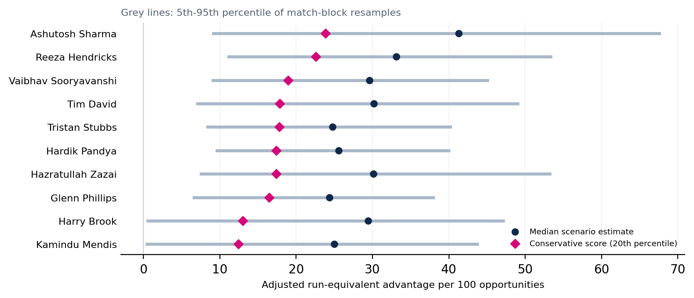
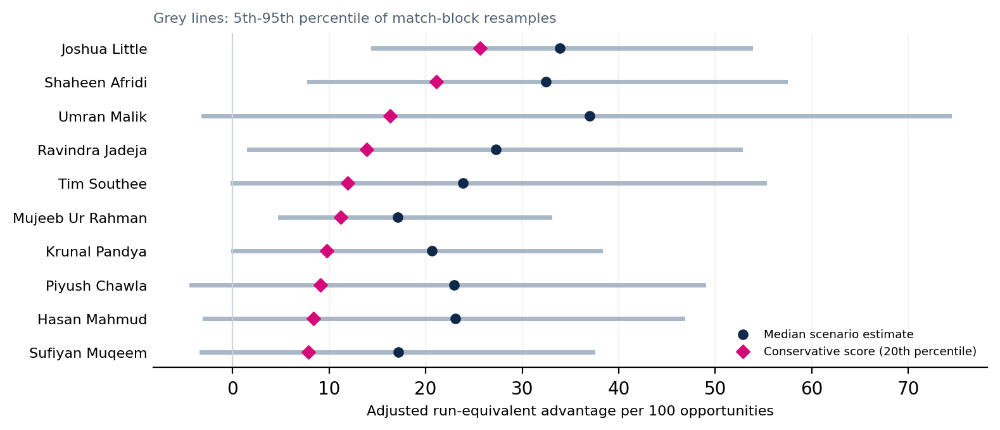
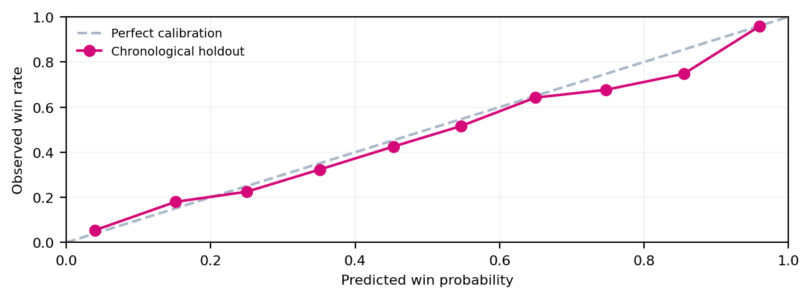

Reliable players
under pressure

SupeRR Selector Season 2 - Round 1 methodology report

AI-assisted analytical draft for Harsh Sinha | 17 November 2026 | Data: 22 January 2022 to 1 November 2026

**Participant review required.** The official rules permit AI assistance but require your own final insights, picks and recommendations. Review and adapt this draft before submitting. The proprietary data pack is kept local and excluded from GitHub. [5]

### Executive Summary

**Ashutosh Sharma** leads the batting list with a conservative score of **23.86**; **Joshua Little** leads bowling at **25.66**. Scores measure context-adjusted run-equivalent advantage per 100 opportunities. They are neither percentages nor probabilities of success. [1, 2]

Pressure is identified **before the delivery**: the contest must still be open, the next ball must be able to shift it, and fewer remaining balls increase urgency. Both first innings and chases count. A six, wicket, final match result, or player reputation cannot make its own ball qualify after the fact.

The final order combines actual pressure performance with improvement over each player's ordinary level. Nine definitions - three pressure cutoffs and three wicket values - are combined within the same match resamples. Small samples are shrunk toward the contextual average, and ranking uses the lower 20th percentile rather than the most optimistic estimate.

The win-probability model achieves **72.49%** match-weighted pre-ball classification accuracy on a later, untouched period (306 matches in 2025-2026), with a 95% match-bootstrap interval of 69.30%-75.59%. This validates the pressure model's predictive component, **not the correctness of a top-10 list**. The brief specifies no accuracy target. [3]

### What these selections mean

The analysis retains **763 complete, decisive IPL/T20I matches** and **182,440 delivery records** from the six supplied CSVs. It ranks historical pressure performance in this coverage, rather than predicting a permanent psychological trait or selecting an available squad for today.

The rankings are complete and ordered, as the brief requires. Several adjacent positions have overlapping uncertainty intervals. Strict early-versus-late rank stability is weak; that result is reported, rather than hidden. The 20 dropdown selections and this document form the two required submission components. [1]

Source key: [1] supplied problem statement; [2] computed rankings; [3] chronological validation; [4] local source audit; [5] official Unstop event rules. Exact references appear on page 14.

---

## Top 10 batters: exact submission order

Sort key: the unrounded conservative score, descending. The table rounds scores for reading only. The middle estimate and 90% resampling band describe the robust nine-scenario rating; the score is its 20th-percentile selection statistic. [2]

| # | Player | Score | Estimate | P units | P matches |
| --- | --- | --- | --- | --- | --- |
| 1 | Ashutosh Sharma | 23.86 | 41.29 | 112 | 12 |
| 2 | Reeza Hendricks | 22.58 | 33.10 | 244 | 24 |
| 3 | Vaibhav Sooryavanshi | 18.96 | 29.60 | 127 | 19 |
| 4 | Tim David | 17.86 | 30.19 | 390 | 46 |
| 5 | Tristan Stubbs | 17.77 | 24.75 | 283 | 34 |
| 6 | Hardik Pandya | 17.39 | 25.57 | 450 | 51 |
| 7 | Hazratullah Zazai | 17.37 | 30.11 | 66 | 9 |
| 8 | Glenn Phillips | 16.49 | 24.35 | 250 | 27 |
| 9 | Harry Brook | 12.98 | 29.44 | 185 | 25 |
| 10 | Kamindu Mendis | 12.44 | 25.00 | 169 | 18 |

P = reference high pressure (top quartile within innings). Batting units are balls faced, including no-balls and excluding wides. Bowling units are legal-ball opportunities with preceding wides/no-balls bundled. A terminal illegal-only opportunity still counts once. Samples shown use the reference definition.

Resampling bands condition on the fitted context/pressure models and eligible candidate set. They do not include all model uncertainty or correct winner-selection bias. The exact names and player IDs are preserved in submission/rankings.csv; match those identities in the Unstop dropdowns.

---

## Top 10 bowlers: exact submission order

Sort key: the unrounded conservative score, descending. The table rounds scores for reading only. The middle estimate and 90% resampling band describe the robust nine-scenario rating; the score is its 20th-percentile selection statistic. [2]

| # | Player | Score | Estimate | P units | P matches |
| --- | --- | --- | --- | --- | --- |
| 1 | Joshua Little | 25.66 | 33.91 | 213 | 24 |
| 2 | Shaheen Afridi | 21.09 | 32.47 | 314 | 35 |
| 3 | Umran Malik | 16.32 | 36.95 | 155 | 18 |
| 4 | Ravindra Jadeja | 13.86 | 27.26 | 320 | 41 |
| 5 | Tim Southee | 11.91 | 23.87 | 202 | 26 |
| 6 | Mujeeb Ur Rahman | 11.21 | 17.13 | 250 | 25 |
| 7 | Krunal Pandya | 9.77 | 20.63 | 328 | 40 |
| 8 | Piyush Chawla | 9.11 | 22.93 | 97 | 16 |
| 9 | Hasan Mahmud | 8.39 | 23.10 | 107 | 12 |
| 10 | Sufiyan Muqeem | 7.84 | 17.19 | 121 | 10 |

P = reference high pressure (top quartile within innings). Batting units are balls faced, including no-balls and excluding wides. Bowling units are legal-ball opportunities with preceding wides/no-balls bundled. A terminal illegal-only opportunity still counts once. Samples shown use the reference definition.

Resampling bands condition on the fitted context/pressure models and eligible candidate set. They do not include all model uncertainty or correct winner-selection bias. The exact names and player IDs are preserved in submission/rankings.csv; match those identities in the Unstop dropdowns.

---

## 1. Pressure exists before the outcome

A late over is not automatically pressure, and an early wicket can matter. The model therefore asks whether a plausible delivery can change an unresolved contest. The definition is identical for the batter and bowler facing the same pre-ball state. [2]

### Reconstruct only information available at that moment

Before each event, accumulate prior team runs and wickets, count only legal balls used, and derive balls left. In a chase, target = first-innings total + 1; required rate = 6 x runs still needed / balls left. In the first innings, no target or future opposition total is used. Innings number, IPL indicator, year and venue country provide context.

Current rate is stabilized as 6 x (score + 25.5) / (balls used + 18). The 18-ball, 8.5-rpo prior prevents a first-ball six from implying a sustainable 36-rpo innings. The pressure model uses no player/team identity, match winner, final margin, eventual innings score, or current-ball result as an input.

### Measure closeness, one-ball swing and urgency

C = 4 x p x (1 - p)
L = 0.30 x max(p6 - p0, 0) + 0.055 x max(p0 - pw, 0)
U = 1 + balls used / 120
Pressure = C x L x U

p is predicted win probability from the current batting side's perspective. p6, p0 and pw are probabilities after a hypothetical legal six, dot and wicket. Each hypothetical state uses one legal ball and updates all rate features. Chase wins/losses at terminal states are set to exactly 1/0. The first innings never uses the actual second-innings outcome to resolve a hypothetical state.

C peaks in an open contest and suppresses almost settled games. L approximates a plausible event swing: 0.30 = a 1.8-run shock / six, while 0.055 is a fixed wicket hazard. These are transparent scale assumptions, not fitted psychological measures. U rises from 1 toward 2 as opportunities disappear. Neither a later six nor a wicket changes its own pressure classification.

High pressure in the reference definition is the top 25% of scores **separately in each innings**: cutoffs 0.032583 (first innings) and 0.039404 (chase). This keeps both tasks represented without allocating a quota to a player, competition or phase. The robust rating also uses the top 30% and 20%.

### A concrete state in the supplied data

Match 31268 (2024-05-02), innings 2: 200/6, target 202, 1 legal ball(s) remaining. Before that event, p = 0.529 and pressure = 0.596. The state qualifies before its actual result is examined.

---

## 2. Compare performance fairly

Raw strike rate and economy answer different questions and depend on match context. The rating first subtracts what an average player would be expected to achieve in that state against that opponent. Positive residuals are good in both roles. [2]

Batting residual = (bat runs - expected bat runs)
- v x (personal dismissal - expected personal dismissal)

Bowling residual = (expected conceded runs - conceded runs)
+ v x (credited wickets - expected credited wickets)

The reference wicket exchange value is v = 12 runs. The final robust system also evaluates v = 8 and 16; it does not claim that every wicket is literally worth 12 runs. Context already controls balls left, wickets lost, score and rate, although a state-dependent wicket value could improve a future version.

### Expected performance comes from other matches

Separate gradient-boosted regressors estimate batting runs, personal dismissal probability, bowling runs and credited wicket count. They use the pressure model's state features, batting order and opponent strength. The batting models add the bowler's prior-match run-equivalent form; the bowling models add the striker's prior-match form. A 300-event prior of +1 for batting / -1 for bowling stabilizes new opponents. Only strictly earlier dates enter those form features; same-day games are frozen together.

Five match-level folds predict every record from models trained on other matches. All events from a match stay together. For each fold, opponent form is rebuilt using training matches only, so held-out results cannot re-enter through future form features. Player name and the player's own identity are not model inputs. IPL/T20I, year and venue-country controls help comparability; they cannot remove every team-strength, pitch or selection difference.

### Extras, dismissals and bowling opportunities

Scoreboard runs include bat runs plus both extras columns. Wides, Overstep and the source's "other" no-ball label consume no legal ball. For batting, wides add no ball faced and earn no batting run credit; a striker dismissed on a wide still receives the wicket loss at that state. Personal non-striker dismissals are not assigned to the striker.

For bowling, bundle consecutive illegal events with the next legal delivery using the legal-ball position. Take context and pressure from the bundle's first event, and sum its conceded runs/wickets. This prevents a one-run wide from looking cheaper than a normal delivery. Only bat runs and wide/no-ball penalties are charged; byes, leg byes and other penalty runs are not. Caught, bowled, LBW, stumped and hit-wicket dismissals earn bowling credit; run-outs and retirements do not.

Six opportunities spanning two bowlers (13 delivery events) are excluded from bowling scoring only, because a bundle cannot be fairly assigned to one bowler. Their match states and batting events remain usable. A terminal illegal delivery can form an opportunity with zero legal balls, preserving its run and wicket cost.

---

## 3. Reward performance and uplift

A player should not lead solely because a weak ordinary record makes improvement easy. Equally, a superb player who simply maintains their level should still receive credit. The formula gives 75% weight to pressure performance and 25% to improvement over the player's own ordinary level. [2]

A = sum(pressure residuals) / (pressure opportunities + 120)
B = sum(ordinary residuals) / (ordinary opportunities + 240)
Uplift = A - B
Reference rating R = 100 x [0.75 A + 0.25 (A - B)]
= 100 x (A - 0.25 B)

A and B are regularized estimates. Adding 120 and 240 neutral pseudo-opportunities shrinks sparse estimates toward zero, the contextual average. The player baseline B uses only ordinary events, rather than using pressure performance in both sides of the comparison. The ordinary pool has a larger prior because it covers a broader context mix. The sensitivity analysis halves and doubles both priors.

### Avoid relying on one cutoff or wicket valuation

Calculate R for all nine combinations of pressure quantile (70th, 75th, 80th) and wicket value (8, 12, 16). Candidate eligibility is fixed by the reference definition; a tighter scenario does not silently remove a player. Shrinkage and resampling handle the smaller scenario sample.

Use the same 2,000 whole-match bootstrap draws for all nine scenarios and every player. Within each draw, take the median of the nine R values for that player. This gives a distribution of a robust rating that does not depend on choosing the most favorable definition.

Final selection score = 20th percentile of robust bootstrap ratings
Displayed estimate = median of the nine original scenario ratings
Displayed 90% band = 5th to 95th percentiles of robust ratings

Higher scores are better. Rank by the full-precision final score; tie-break by more reference pressure opportunities and then player name. A score of +20 means a conservative +20 run-equivalent advantage per 100 opportunities under this model. It does not mean 20% accuracy, 20% win probability, or a guaranteed extra 20 actual runs.

### Eligibility is identical in principle for both roles

| Reference requirement | Rule |
| --- | --- |
| Pressure sample | At least 60 batting balls / bowling opportunities |
| Pressure repetition | At least 8 distinct pressure matches |
| Ordinary baseline | At least 120 ordinary opportunities |
| Overall repetition | At least 12 matches and 2 calendar years |

This leaves 176 eligible batters and 175 eligible bowlers. No player was included through reputation or manual substitution. Historical eligibility is not an assertion of current fitness, selection or availability.

---

## 4. Reliability is measured across matches

Balls from the same match are dependent: they share the pitch, opposition and conditions. Resampling individual balls would make the evidence look more precise than it is. Every draw therefore resamples whole matches with replacement and keeps all player events and all scenarios from a selected match together. [2]

### Three complementary checks

| Check | What it reveals |
| --- | --- |
| Match-block 90% band | How the robust estimate changes when the observed match sample changes. |
| Positive pressure matches | Share of reference pressure matches with positive total adjusted residual. This measures repetition; it is not a match-win rate. |
| Top-10 resampling frequency | How often the conservative ranking places a player in the top 10 in the same candidate pool. It is not the probability the player is truly top 10. |

For the last check, each resampled robust estimate retains the player's original estimate-to-score penalty, and all candidates are re-ranked. The fitted nuisance models, eligibility and pressure thresholds remain fixed. Frequencies are diagnostic rather than a calibrated probability of selection.

### Check dependence on one performance

For every selected player, remove the match with the largest absolute reference pressure residual and recalculate the reference point rating. This catches both one-match spikes and sensitivity to one poor match. The leave-one-match-out table is a point-estimate stress test: it does not refit models or recompute the entire ranking.

| Role | Lowest - highest positive-match share | Largest single-match absolute share |
| --- | --- | --- |
| Batters | 61.1% - 77.8% | 35.6% |
| Bowlers | 48.8% - 75.0% | 23.6% |

The absolute-share measure divides the largest absolute match residual by the sum of absolute match residuals. It is a concentration diagnostic, rather than the share of a player's net value. A positive robust score and a high positive-match share measure different forms of reliability; both are shown, rather than forcing one to impersonate the other.

### What the uncertainty does not cover

These bands condition on the available dataset, fitted context models, candidate selection and the nine-scenario design. They omit complete model-estimation uncertainty, unobserved opposition quality and winner-selection bias from evaluating many players. Broad bands and closely spaced scores should be read as tiers of evidence, even though Unstop requires one exact order.

---

## 5. Accuracy: a later-period test

Train on 457 matches in 2022-2024; evaluate on 306 different matches in 2025-2026 (72,484 delivery states). No later outcome trains these validation models. The main historical rankings use match cross-fitting; this separate chronological test checks whether the pressure model generalizes forward in time. [3]

| Win-probability metric | Model | Historical innings prior | Neutral 50% |
| --- | --- | --- | --- |
| Pre-ball accuracy | 72.49% | 46.08% | 48.66% |
| Brier score (lower is better) | 0.1792 | 0.2525 | 0.2500 |
| ROC AUC | 0.8097 | - | - |

Accuracy uses a 0.5 decision threshold. Its 95% match-bootstrap interval is 69.30%-75.59%; the Brier interval is 0.1634-0.1955. Each match has equal total weight, so long matches do not dominate. The historical baseline uses training-period win frequency by innings; its poor later accuracy reflects a period shift, so the neutral baseline is also included.

Calibration bins span 0.1 in predicted probability. The observed rates and predicted means use equal-match weighting within each bin; bin sizes are recorded in chronological_calibration.csv.

### Context models offer modest improvement over constant predictions

| Outcome model | Holdout RMSE | Constant-mean RMSE |
| --- | --- | --- |
| bat_runs | 1.7641 | 1.7883 |
| bat_out | 0.2270 | 0.2277 |
| bowl_runs | 1.8032 | 1.8296 |
| bowl_out | 0.2250 | 0.2255 |

Performance-model RMSE is opportunity-weighted within each role, not match-weighted. Binary/count wicket RMSE is reported instead of misleading near-95% "accuracy" from predicting no wicket every time. The improvement is modest. Neither this nor win-prediction accuracy supplies a ground-truth pressure ranking.

---

## 6. Test definition and time sensitivity

The final score already combines nine pressure/wicket scenarios. These additional single-scenario stress tests measure how many of its ten selected players survive alternative assumptions. They do not imply an alternative list is incorrect. Context predictions and the 12-run opponent-form feature remain fixed in the wicket-value tests. [2, 3]

| Stress test | Batters retained | Bowlers retained |
| --- | --- | --- |
| Pressure: top 30% | 8/10 | 6/10 |
| Pressure: top 20% | 8/10 | 8/10 |
| Wicket value: 8 | 6/10 | 7/10 |
| Wicket value: 16 | 8/10 | 7/10 |
| Prior strength: half | 8/10 | 9/10 |
| Prior strength: double | 7/10 | 8/10 |
| Uplift weight: 0% | 7/10 | 8/10 |
| Uplift weight: 50% | 6/10 | 7/10 |
| IPL-only population | 4/10 | 4/10 |
| T20I-only population | 5/10 | 4/10 |

Standalone sensitivity lists use 1,000 resamples and their own reference eligibility, while the final robust list uses 2,000. Population-only tests change both eligibility and competition coverage; they are not pure parameter perturbations.

### A strict temporal ranking test gives a caution

For this test, create 2022-2024 rankings using match-cross-fitted models trained only within that period. Freeze its pressure cutoffs, then predict 2025-2026 performance from 2022-2024 models. Opponent form uses only matches already played. No later labels determine the earlier list or the later pressure cutoffs.

| Role | Eligible in both | Rank correlation | Early top 10 later eligible | Top-10 overlap |
| --- | --- | --- | --- | --- |
| Batters | 59 | 0.232 | 7/10 | 1/10 |
| Bowlers | 60 | 0.105 | 4/10 | 0/10 |

**Persistence is weak.** Form changes, limited pressure samples and changing coverage all matter. The final lists summarize the full supplied history; they should not be advertised as validated forecasts of a permanent clutch trait. This limitation is more consequential than a small decimal difference between adjacent scores.

---

## 7. Evidence for the ten batters

Reference pressure = top quartile; the normal comparison is the same player's remaining opportunities. A and B are the adjusted, regularized advantages from the scoring formula, shown per 100 balls. Raw strike rates are descriptive and are not themselves the ranking score. [2]

| # | Batter | P SR | Normal SR | P outs | A | B | A-B |
| --- | --- | --- | --- | --- | --- | --- | --- |
| 1 | Ashutosh Sharma | 195.5 | 156.2 | 5 | 42.8 | 5.9 | 36.9 |
| 2 | Reeza Hendricks | 152.9 | 141.6 | 4 | 36.4 | 3.2 | 33.1 |
| 3 | Vaibhav Sooryavanshi | 205.5 | 222.0 | 4 | 32.6 | 26.0 | 6.6 |
| 4 | Tim David | 167.7 | 183.5 | 14 | 38.0 | 31.3 | 6.7 |
| 5 | Tristan Stubbs | 140.6 | 152.9 | 7 | 27.4 | 10.4 | 16.9 |
| 6 | Hardik Pandya | 142.0 | 140.5 | 12 | 25.1 | -2.0 | 27.1 |
| 7 | Hazratullah Zazai | 156.1 | 115.2 | 1 | 25.6 | -17.9 | 43.5 |
| 8 | Glenn Phillips | 140.4 | 153.9 | 6 | 25.9 | 6.3 | 19.6 |
| 9 | Harry Brook | 169.7 | 159.3 | 10 | 20.5 | 13.2 | 7.3 |
| 10 | Kamindu Mendis | 132.0 | 131.7 | 6 | 15.7 | -4.7 | 20.4 |

### Why performance and uplift both matter

**1. Ashutosh Sharma** - RR scouting use: late-order hitting (modal position 7). Positive pressure matches 75.0%; top-10 resamples 55.6%.

**2. Reeza Hendricks** - RR scouting use: opening batting (modal position 2). Positive pressure matches 62.5%; top-10 resamples 61.1%.

**3. Vaibhav Sooryavanshi** - RR scouting use: opening batting (modal position 2). Positive pressure matches 63.2%; top-10 resamples 42.5%.

**4. Tim David** - RR scouting use: middle-order batting (modal position 5). Positive pressure matches 67.4%; top-10 resamples 40.6%.

**5. Tristan Stubbs** - RR scouting use: middle-order batting (modal position 5). Positive pressure matches 70.6%; top-10 resamples 48.5%.

**6. Hardik Pandya** - RR scouting use: middle-order batting (modal position 4). Positive pressure matches 64.7%; top-10 resamples 39.0%.

**7. Hazratullah Zazai** - RR scouting use: opening batting (modal position 1). Positive pressure matches 66.7%; top-10 resamples 39.4%.

**8. Glenn Phillips** - RR scouting use: middle-order batting (modal position 4). Positive pressure matches 77.8%; top-10 resamples 39.6%.

**9. Harry Brook** - RR scouting use: middle-order batting (modal position 5). Positive pressure matches 64.0%; top-10 resamples 21.4%.

**10. Kamindu Mendis** - RR scouting use: middle-order batting (modal position 5). Positive pressure matches 61.1%; top-10 resamples 26.1%.

Strong usual performers can rank through A even with little uplift. A weak usual record influences only 25% of the rating; low-sample selections remain uncertain despite shrinkage.

---

## 8. Evidence for the ten bowlers

Economy = 6 x conceded runs / legal deliveries. Pressure samples count bundles; wickets can occur on an illegal delivery. Raw economy is shown beside the player's ordinary economy, while A/B adjust for different state difficulty and opposition. [2]

| # | Bowler | P wkts | P econ | Normal econ | A | B | A-B |
| --- | --- | --- | --- | --- | --- | --- | --- |
| 1 | Joshua Little | 15 | 6.45 | 8.78 | 35.9 | -6.9 | 42.8 |
| 2 | Shaheen Afridi | 26 | 7.51 | 8.14 | 31.9 | -2.3 | 34.2 |
| 3 | Umran Malik | 17 | 9.37 | 9.93 | 33.2 | -15.1 | 48.2 |
| 4 | Ravindra Jadeja | 20 | 7.61 | 7.99 | 26.5 | -3.0 | 29.5 |
| 5 | Tim Southee | 15 | 6.95 | 8.67 | 28.8 | -1.9 | 30.7 |
| 6 | Mujeeb Ur Rahman | 13 | 6.36 | 7.33 | 20.2 | 12.4 | 7.8 |
| 7 | Krunal Pandya | 14 | 6.53 | 8.37 | 21.6 | 2.6 | 19.0 |
| 8 | Piyush Chawla | 8 | 8.10 | 8.43 | 24.3 | 8.9 | 15.5 |
| 9 | Hasan Mahmud | 8 | 7.18 | 7.91 | 19.3 | -4.1 | 23.4 |
| 10 | Sufiyan Muqeem | 7 | 5.90 | 6.81 | 18.6 | 11.2 | 7.3 |

**1. Joshua Little** - RR scouting use: powerplay pace. Positive pressure matches 58.3%; top-10 resamples 74.8%.

**2. Shaheen Afridi** - RR scouting use: powerplay pace. Positive pressure matches 57.1%; top-10 resamples 56.8%.

**3. Umran Malik** - RR scouting use: middle pace. Positive pressure matches 55.6%; top-10 resamples 42.3%.

**4. Ravindra Jadeja** - RR scouting use: middle spin. Positive pressure matches 48.8%; top-10 resamples 32.5%.

**5. Tim Southee** - RR scouting use: powerplay pace. Positive pressure matches 61.5%; top-10 resamples 35.8%.

**6. Mujeeb Ur Rahman** - RR scouting use: powerplay spin. Positive pressure matches 64.0%; top-10 resamples 21.5%.

**7. Krunal Pandya** - RR scouting use: middle spin. Positive pressure matches 55.0%; top-10 resamples 16.4%.

**8. Piyush Chawla** - RR scouting use: middle spin. Positive pressure matches 56.2%; top-10 resamples 26.9%.

**9. Hasan Mahmud** - RR scouting use: middle pace. Positive pressure matches 75.0%; top-10 resamples 20.9%.

**10. Sufiyan Muqeem** - RR scouting use: middle spin. Positive pressure matches 70.0%; top-10 resamples 17.4%.

RR scouting uses on pages 10-11 describe observed roles and the phase with most pressure exposure, not proven team weaknesses or auction availability. They are proposals for participant judgment. Wicket-value scenarios test the tradeoff between wickets and run prevention.

---

## 9. Source audit and fair comparison

The supplied files contain 883 match records and 200,999 delivery events. No exact duplicate rows or duplicate match/innings/delivery-sequence keys were found. Join every delivery to a unique match, then a unique competition. Match/player/team identity uses IDs, never names. [4]

| Source | Use |
| --- | --- |
| competitions.csv | Identify IPL/T20I scope, season and competition. |
| teams.csv | Validate competition-team identities. |
| matches.csv | Dates, venue country, innings revisions and outcome checks. |
| ball_by_ball.csv | Reconstruct state, extras, legal balls, runs and dismissals. |
| competition_team_player_mapping.csv | Validate roster identity by competition + team + player ID. |
| playing_eleven.csv | Validate match + team + player ID, including impact players. |

All retained striker events match the competition roster; all retained striker and bowler events match a playing-XI record (0, 0, 0 unmatched events respectively). There is no join multiplication. Impact status is retained for validation rather than used to assume a player was on the field for every ball.

| Exclusion trigger | Matches | Exclusion trigger | Matches |
| --- | --- | --- | --- |
| no decisive result | 41 | winner score mismatch | 19 |
| revised or shortened | 34 | no deliveries | 16 |
| chase incomplete | 31 | regulation tie | 9 |
| outside IPL T20I | 30 | incomplete or overfull over | 3 |
| first innings incomplete | 24 | unlabelled extras | 2 |
| missing innings | 22 |  |  |

Triggers overlap; they must not be added. Exactly 120 matches are excluded. Outside-scope matches belong to two emerging-team tournaments. 38 Super Over events are omitted; regulation ties are excluded. No-result, revised/DLS, incomplete and inconsistent matches cannot supply comparable complete 120-ball states. Both innings are excluded together when a match fails an inclusion check.

The source label "other" appears 264 times and is treated as a no-ball because this reconciles completed overs to six legal balls. Two matches have unlabelled extras; three have incomplete/overfull interior overs. They are excluded explicitly. Six multi-bowler opportunities are excluded only from bowling scoring, as described earlier.

---

## 10. Competition coverage and limitations

| Competition | Retained matches | Delivery events | Pressure events |
| --- | --- | --- | --- |
| IPL | 351 | 84,815 | 20,707 |
| T20I | 412 | 97,625 | 24,903 |

Pool compatible match states while controlling format, year, venue country, innings, score, wickets, balls remaining, batting order and pre-match opponent form. Do not require an IPL appearance: that would exclude international players for lack of access to one league. Equally, do not treat all T20I opposition as equally strong. Opponent-form controls and population-only tests reduce, but do not eliminate, this problem. [2, 4]

### Pressure is distributed across both innings and phases

| Innings | Phase | All events | Pressure events | Pressure share |
| --- | --- | --- | --- | --- |
| 1 | Death | 23,833 | 4,830 | 20.3% |
| 1 | Middle | 42,623 | 8,980 | 21.1% |
| 1 | Powerplay | 28,596 | 9,953 | 34.8% |
| 2 | Death | 17,287 | 4,465 | 25.8% |
| 2 | Middle | 41,485 | 11,467 | 27.6% |
| 2 | Powerplay | 28,616 | 5,915 | 20.7% |

Powerplay: legal balls 1-36; middle: 37-90; death: 91-120. These are event counts before bowling bundling and use the reference threshold. No phase has a player-selection quota.

### Limits that change interpretation

**Historical reliability is not a permanent trait.** The temporal test is weak. Pressure exposure, role, selection and form can change; retired players are not removed from historical rankings simply because they are unavailable today.

**Pressure is a model of stakes, not measured stress.** First-innings stakes are inferred from neutral-context win probability. Crowd, tournament qualification, personal milestones, injury, weather and specific bowler-batter matchups are not measured. Knockout status receives no arbitrary bonus.

**Model uncertainty remains.** Context improvements over a constant mean are modest. Match-block resampling captures match-sample variation, not the full model-fitting and multiple-comparison problem. The robust scenario design addresses selected assumptions, not every possible pressure definition.

**Attribution is partial.** Dismissals reflect fielding as well as batting/bowling skill. Striker run-outs are charged to the dismissed striker; non-striker run-outs change the team state without charging the striker. Tactical retire-outs are personal dismissals but never bowling wickets. Byes, catches and fielding quality are not independent player ratings here.

**Coverage follows the supplied data.** Excluding shortened and unresolved matches improves comparability but narrows scope. Dates and records are accepted as supplied; the analysis does not independently certify provider accuracy or completeness against every real-world IPL/T20I match.

---

## 11. Reproduction and participant review

The local workspace contains the six original CSVs and unchanged brief. The public repository excludes the proprietary pack, prediction caches and record-level audits under organizer rules. It contains code, source hashes, aggregated evidence, ranked draft selections and this report. Authorized participants must place their own pack in data/raw/ to reproduce the analysis. No external cricket data or API key is required. [4, 5]

python3 -m venv .venv
source .venv/bin/activate
pip install -r requirements.txt
python src/analyse.py
python src/build_report.py
python src/verify.py

Use Python 3.12 and the pinned dependencies. Random seed = 20261117; final bootstrap draws = 2000; sensitivity/temporal draws = 1,000. The seed controls match folds and multinomial whole-match resampling. The full-precision CSVs are authoritative if displayed decimals coincide.

### Model settings and decision rules

Win model: HistGradientBoostingClassifier; 140 iterations, learning rate 0.065, 15 leaves, minimum 200 samples/leaf, L2 = 15, early stopping off. Monotonic directions: balls left and score positive; wickets lost, target and required rate negative; stabilized current rate positive; other features unconstrained. Outcome: current batting team eventually wins the regulation match.

Performance models: HistGradientBoostingRegressor; squared-error loss; 110 iterations, learning rate 0.07, 15 leaves, minimum 200 samples/leaf, L2 = 15, early stopping off. Run predictions clipped to [0,10]; wicket expectations to [0,1]. All four use five grouped match folds; the chronological validation refits only on 2022-2024.

### Final Unstop actions

Review the evidence and add your own cricketing judgment, final picks and RR recommendations before submitting: the official rules permit AI assistance but warn against copied or wholly AI-generated submissions. Participation is individual, only one entry is allowed, and the data pack must not be shared or published. Check registration and the final submission deadline in your logged-in portal. Shortlisted participants must be able to travel and carry valid photo ID. [5]

Once you have finalized your own picks, synchronize the report and CSV, choose the ten players in rank order in each Unstop dropdown, and upload the report. Do not duplicate a player within a list. Portal entry and final submission have not occurred. The optional journey component is not required and does not affect evaluation. [1]

[1] local data/raw/problem_statement.pdf, both pages. [2] output/tables/{batters,bowlers}_all.csv and *_robust_scenarios.csv; sensitivity, temporal_stability and leave_one_match_out tables. [3] output/validation.json and chronological_calibration.csv. [4] data/manifest.json and local-only output/audit.json and match_audit.csv; source hashes checked by src/verify.py. [5] Official Unstop event listing, rules checked 17 November 2026: https://api.unstop.com/hackathons/superr-selector-season-2-help-shape-rajasthan-royals-ipl-2027-auction-strategy-rajasthan-royals-1792758
